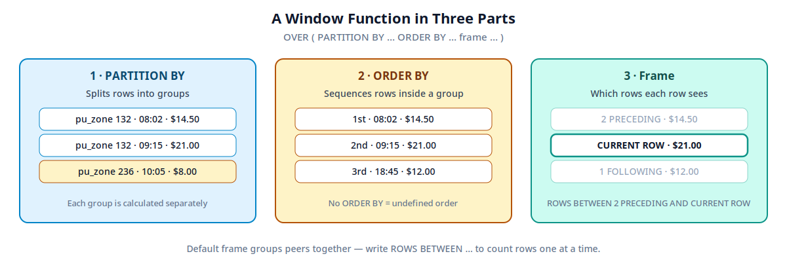
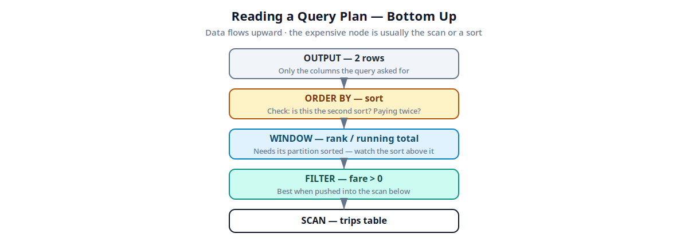

title: SQL for Data Engineering: Window Functions, CTEs, and Reading a Query Plan (Day 2 of 30)
author: Krishna Prasad Chapagain
date: 2026-11-21
summary: Day 2 of the 30-day plan goes beyond SELECT: window functions that rank, compare, and accumulate without collapsing rows, CTEs that make pipelines readable, and how to read a query plan like an engineer. All queries run in DuckDB on a small NYC taxi sample you can copy-paste.
slug: day-02-sql-for-data-engineering
tags: ["Data Engineering", "SQL", "DuckDB", "Learning"]
---

# SQL for Data Engineering: Window Functions, CTEs, and Reading a Query Plan (Day 2 of 30)

*This is Day 2 of a 30-day plan to learn data engineering across AWS, Azure, and GCP — one article a day, each ending with something to build. Yesterday we mapped the job; today we go hands-on with the skill that separates a data engineer from someone who just writes queries: SQL that transforms data without losing rows.*


## Why SQL is still the core skill

Every tool in the modern stack — Glue, dbt, Spark, BigQuery — eventually compiles down to SQL, or to something shaped exactly like it. A pipeline is a SQL query with a schedule attached. So the fastest way to get better at data engineering is to get better at the SQL that does the transforming, not just the SQL that answers a question.

Three ideas carry most of that weight: window functions, CTEs, and reading query plans. Today covers all three, on one small dataset you can run anywhere.

## The dataset: NYC yellow taxi trips

Day 1 asked you to pick a dataset; this article uses NYC yellow taxi trips, the same one many of these labs use. To keep everything copy-pasteable, here is a tiny version of it — 8 rows, with a deliberate duplicate and one bad row (a $−5.00 fare) baked in, because real data always has both:

```sql
CREATE TABLE trips AS SELECT * FROM (VALUES
 (1, '2026-11-01 08:02:00'::TIMESTAMP, '2026-11-01 08:20:00'::TIMESTAMP, 132, 236, 2, 3.2, 14.50),
 (1, '2026-11-01 08:02:00'::TIMESTAMP, '2026-11-01 08:20:00'::TIMESTAMP, 132, 236, 2, 3.2, 14.50),
 (2, '2026-11-01 09:15:00'::TIMESTAMP, '2026-11-01 09:40:00'::TIMESTAMP, 132, 170, 1, 5.1, 21.00),
 (1, '2026-11-01 10:05:00'::TIMESTAMP, '2026-11-01 10:12:00'::TIMESTAMP, 236, 132, 3, 1.1, 8.00),
 (2, '2026-11-02 08:30:00'::TIMESTAMP, '2026-11-02 08:55:00'::TIMESTAMP, 132, 236, 2, 4.0, 18.50),
 (1, '2026-11-02 12:00:00'::TIMESTAMP, '2026-11-02 12:30:00'::TIMESTAMP, 170, 132, 1, 6.8, 27.00),
 (2, '2026-11-02 18:45:00'::TIMESTAMP, '2026-11-02 19:10:00'::TIMESTAMP, 132, 170, 4, 2.5, 12.00),
 (1, '2026-11-02 19:20:00'::TIMESTAMP, '2026-11-02 19:22:00'::TIMESTAMP, 132, 236, 1, 0.0, -5.00)
) AS t(vendor_id, pickup, dropoff, pu_zone, do_zone, passengers, distance_mi, fare);
```

Columns: vendor, pickup and dropoff times, pickup and dropoff zones, passengers, distance in miles, fare in dollars. Run it in DuckDB (`pip install duckdb`, then `duckdb` on the command line) and every query below works as written.

## CTEs: give each step a name

A CTE (Common Table Expression, the `WITH ...` block) is how a pipeline stays readable. Each CTE is one transformation with a name, so the final `SELECT` reads like a recipe instead of a nested puzzle. This is also exactly how dbt models are structured — one model, one transformation — so the habit transfers directly to Day 22.

Cleaning and deduping in two named steps:

```sql
WITH cleaned AS (
  SELECT * FROM trips
  WHERE fare > 0 AND distance_mi > 0 AND dropoff > pickup
),
deduped AS (
  SELECT *, ROW_NUMBER() OVER (
    PARTITION BY vendor_id, pickup, dropoff, fare
    ORDER BY vendor_id
  ) AS rn FROM cleaned
)
SELECT count(*) AS kept FROM deduped WHERE rn = 1;
-- kept: 6  (8 rows in, 1 duplicate and 1 bad fare removed)
```

Two rules worth internalising: filter bad rows *before* the window function runs, so the window never sees data you have already decided to throw away; and dedupe with `ROW_NUMBER()` over the business key — the columns that make two rows "the same trip" — keeping `rn = 1`.

## Window functions: aggregates that keep their rows

A normal `GROUP BY` collapses rows. A window function does not: it computes something *over* a set of related rows and attaches the answer to each row. That is what makes it the workhorse of pipeline SQL — ranking, running totals, previous-row comparisons, and moving averages, all without a self-join.

The anatomy is three parts:



- **PARTITION BY** splits rows into groups. Leave it out and the whole table is one group.
- **ORDER BY** sequences rows inside each group. Leave it out and the order is undefined — and your results will quietly differ between runs.
- **The frame** (`ROWS BETWEEN ...`) decides which rows each calculation actually sees. This is the part most people skip, and the part that causes the most wrong numbers.

One query, three window functions at once, on the cleaned trips:

```sql
WITH cleaned AS (
  SELECT * FROM trips WHERE fare > 0 AND distance_mi > 0 AND dropoff > pickup
)
SELECT pickup::DATE AS day, pu_zone, fare,
  RANK() OVER (PARTITION BY pickup::DATE, pu_zone ORDER BY fare DESC) AS fare_rank,
  SUM(fare) OVER (PARTITION BY pickup::DATE ORDER BY pickup
    ROWS BETWEEN UNBOUNDED PRECEDING AND CURRENT ROW) AS running_fare,
  LAG(fare) OVER (PARTITION BY pu_zone ORDER BY pickup) AS prev_fare
FROM cleaned ORDER BY day, pickup;
```

What comes back, and what it teaches:

| day | pu_zone | fare | fare_rank | running_fare | prev_fare |
|---|---|---|---|---|---|
| 2026-11-01 | 132 | 14.50 | 2 | 14.50 | — |
| 2026-11-01 | 132 | 14.50 | 2 | 29.00 | 14.50 |
| 2026-11-01 | 132 | 21.00 | 1 | 50.00 | 14.50 |
| 2026-11-01 | 236 | 8.00 | 1 | 58.00 | — |
| 2026-11-02 | 132 | 18.50 | 1 | 18.50 | 21.00 |
| 2026-11-02 | 170 | 27.00 | 1 | 45.50 | — |
| 2026-11-02 | 132 | 12.00 | 2 | 57.50 | 18.50 |

- **`RANK()` vs `ROW_NUMBER()`:** the two $14.50 trips tie at rank 2 — `RANK()` leaves a gap (there is no rank 3 in that group), while `ROW_NUMBER()` would have forced them into 2 and 3 arbitrarily. Use `RANK()` when ties are real, `ROW_NUMBER()` when you need exactly one winner, as in the dedupe above.
- **`LAG()`** looks at the previous row in the partition — the standard way to spot a fare jump, a missing day, or a sensor that stopped reporting.
- **The frame matters:** `SUM(...) OVER (ORDER BY pickup)` without an explicit frame defaults to `RANGE UNBOUNDED PRECEDING AND CURRENT ROW`, which groups *peers* — rows with the same ordering value — together. The two 08:02 trips are peers, so a default-frame running total would credit both with 29.00. Writing `ROWS BETWEEN UNBOUNDED PRECEDING AND CURRENT ROW` makes the running total count rows one at a time, which is almost always what a pipeline wants.

A moving average is the same idea with a sliding frame:

```sql
SELECT pickup, fare,
  AVG(fare) OVER (ORDER BY pickup
    ROWS BETWEEN 2 PRECEDING AND CURRENT ROW) AS avg_last_3
FROM trips WHERE fare > 0 ORDER BY pickup;
-- the first three fares average to 14.50, 14.50, then 16.67
```

## Reading a query plan: where the time actually goes

When a query is slow, the fix is almost never "write it differently and hope". It is: read the plan, find the expensive node, fix that node. In DuckDB, `EXPLAIN` shows the plan and `EXPLAIN ANALYZE` shows the plan with real timings:

```sql
EXPLAIN SELECT pu_zone, AVG(fare) FROM trips
WHERE fare > 0 GROUP BY pu_zone;
```



Read it bottom-up — data flows upward:

1. **Scan** — how the table is read. A sequential scan of a small table is fine; a sequential scan of a billion-row table with no partition filter is the problem. Check whether the filter got pushed *into* the scan (DuckDB shows `Filters: fare > 0.00` on the scan node itself) — that is filter pushdown working, and it is the single biggest free win in pipeline SQL.
2. **Filter / Projection** — which columns survive. `SELECT *` forces every column through every later node. Listing only the columns you need is not style advice; it is a performance decision, and on columnar storage it is often a large one.
3. **Window / Aggregate / Sort** — the expensive operators. A window function needs its partition sorted; if the plan shows a big sort feeding the window, and the same sort runs again for the `ORDER BY`, you are paying twice. Sorting once — or partitioning the data so each window is small — is the fix.
4. **Timings** — `EXPLAIN ANALYZE` adds real row counts and times per node. Trust those over the estimates: if a node says "1 row estimated" and processed a million, the planner was guessing, and the query deserves a second look.

The three smells to check first, on any engine: a full scan where a partition or date filter should have applied, a sort that dwarfs everything else, and a `SELECT *` feeding a window or join.

## The same SQL, three clouds

The syntax above is standard SQL and runs as written in DuckDB, Athena/Presto, and Spark SQL. The differences are small but worth knowing early:

| | DuckDB / Athena | BigQuery | Redshift / Snowflake |
|---|---|---|---|
| Filter a window result | Wrap in a CTE, filter outside | `QUALIFY` — filter window results directly | `QUALIFY` (Snowflake); CTE on Redshift |
| Window functions | Full support | Full support | Full support |
| `EXPLAIN` | `EXPLAIN` / `EXPLAIN ANALYZE` | Query plan in the console | `EXPLAIN` in the console |

BigQuery's `QUALIFY` is the one genuinely nicer spelling — `SELECT ... QUALIFY ROW_NUMBER() OVER (...) = 1` replaces the whole dedupe CTE wrapper. Everything else is the same mental model, which is the point of learning it once, locally, in DuckDB.

## Day 2 exercise: window-function queries on your dataset (30 minutes)

Use the dataset you picked on Day 1 — or the taxi sample above — and write four queries:

1. **Dedupe it.** Find the columns that define a duplicate in your data, rank with `ROW_NUMBER()`, and count how many rows survive. Write the number down; Day 7's lakehouse will need it.
2. **Rank within a group.** Pick a grouping that means something (zone and day, product and week) and rank rows inside it with `RANK()`. Note where ties happen and whether they are real.
3. **Compare with the previous row.** Use `LAG()` to find the biggest jump between consecutive rows in one partition — a fare spike, a price change, a gap in a time series.
4. **Read a plan.** Run `EXPLAIN ANALYZE` on your ranking query. Find the scan node: did your filter get pushed into it? Find the sort: is it bigger than the scan? Write down the one node you would fix first.

Keep the queries — Day 3 models the same dataset as a star schema, and Day 7 builds the bronze/silver/gold layers from it.

Tomorrow, Day 3: Data Modeling — star schemas, Data Vault, and medallion architecture, and why the shape of your tables decides the quality of every answer built on them.
